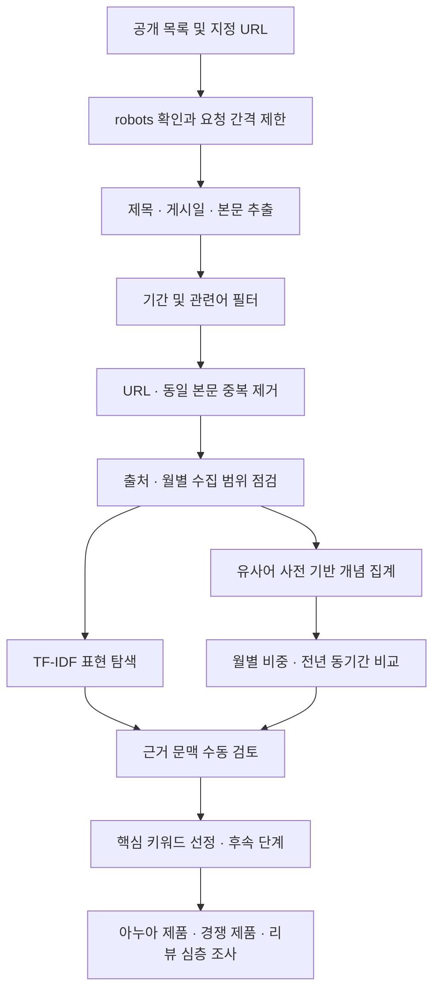
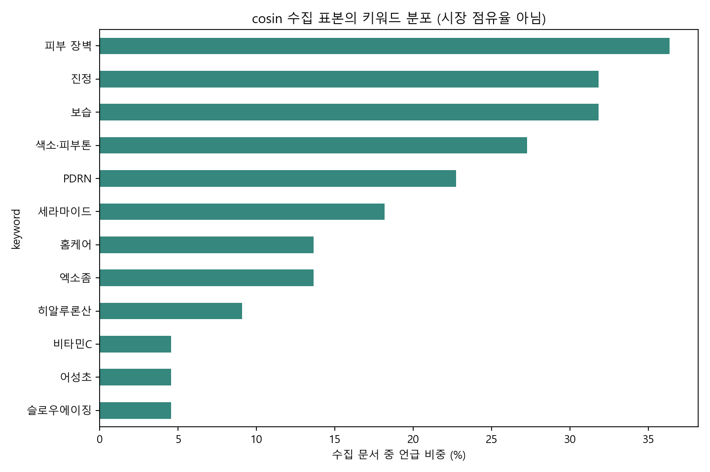

# 국내 뷰티 텍스트 데이터 기반 트렌드 탐색

**크롤링 → 텍스트 정제 → 키워드 탐색 → 기간별 비교 → 아누아 제품 심층 리서치**

국내 뷰티 기사와 공개 리포트를 수집해 어떤 성분·효능·피부 고민이 언급되는지 분석하는 개인 프로젝트입니다. 분석으로 발견한 트렌드 후보를 아누아(ANUA) 관련 브랜드·제품 조사로 연결하는 것을 목표로 합니다.

현재는 **수집·분석 파이프라인 구현 및 소량 실제 자료 검증 단계**입니다. 2026년 핵심 트렌드를 확정하거나 소비자 리뷰 분석을 완료한 프로젝트가 아닙니다. 아누아 및 더파운더즈의 공식 프로젝트가 아닙니다.

## 1. 분석 목적과 질문

1. 뷰티 콘텐츠에서 어떤 성분·효능·피부 고민이 반복적으로 등장하는가?
2. 동일 출처의 전년 같은 기간과 비교했을 때 어떤 개념의 언급 비중이 변화했는가?
3. 발견한 개념은 아누아의 어떤 제품과 연결되는가?
4. 후속 리뷰 조사에서 브랜드가 강조하는 특징과 소비자의 경험은 얼마나 일치하는가?

미리 특정 성분을 결론으로 정하기보다, 새로운 표현을 탐색하고 원문을 검토한 뒤 핵심 키워드를 선정하도록 구성했습니다.

## 2. 진행 상태

| 단계 | 현재 상태 |
|---|---|
| 공개 기사 수집·본문/게시일 추출 | 구현 및 실제 실행 |
| URL·동일 본문 중복 제거 | 구현 |
| TF-IDF 표현 탐색·유사어 사전 집계 | 구현 |
| 출처·월별 비중 / 전년 동기간 비교 | 구현, 과거 자료 확보 필요 |
| 아누아 관련 기사·키워드 추출 | 구현, 현재 표본 내 관련 기사 0건 |
| 브라우저 대시보드 | 구현, 로컬 HTML 생성 |
| 다매체 교차 검증·최종 트렌드 선정 | 미완료 |
| 아누아 제품·경쟁 제품 비교 | 후속 조사 |
| 소비자 리뷰 크롤링·감성 분석 | 수집기 미구현, 확보한 리뷰의 속성 검토표 생성만 지원 |

## 3. 데이터 수집 방식

### 출처와 역할

| 출처 | 수집 방식 | 사용 목적 |
|---|---|---|
| [코스인코리아 전체 뉴스](https://www.cosinkorea.com/news/article_list_all.html) | 목록 페이지에서 기사 URL 발견 → 상세 페이지 요청 | 기사 텍스트 분석 모집단 |
| [화해 비즈니스 공개 트렌드 리포트](https://business.hwahae.co.kr/insight/trendreport-26-3q-trend-snap/) | 설정한 단일 URL의 공개 섹션 일부 추출 | 별도 참고 자료, 통계 분모에서 제외 |

독립적인 뉴스 매체는 현재 한 곳입니다. 화해의 목적 선택 리포트를 두 번째 뉴스 모집단으로 취급하지 않습니다.

### 요청과 추출

- `requests`로 HTML을 요청하고 `BeautifulSoup`으로 파싱합니다.
- 출처별 `robots.txt`를 먼저 확인합니다. 정책을 확인할 수 없거나 허용되지 않은 경로는 수집하지 않습니다.
- 최소 2초 간격을 두고 출처별 상세 요청 수를 제한합니다. robots의 crawl-delay가 더 크면 해당 값을 반영합니다.
- 인증서 검증을 유지하며, 오류 응답·리디렉션·추출 실패는 로그에 남깁니다. 로그인·차단을 우회하지 않습니다.
- 코스인 본문은 `#news_body_area`, 화해 참고 본문은 `section.sec` 선택자로 추출합니다. 전체 페이지의 메뉴·추천 기사를 본문에 섞지 않습니다.
- JSON-LD의 `datePublished`를 사용합니다. 웹페이지 상단의 오늘 날짜나 `dateModified`를 게시일로 대체하지 않습니다.
- 제목·유효한 게시일·150자 이상의 본문이 없으면 제외합니다.
- 날짜 범위와 넓은 뷰티 관련어 필터를 적용합니다. 현재 필터에는 화장품 산업·기업 기사도 포함됩니다.
- 원문 URL, 게시일, 수집 시각, 출처, 본문 해시와 참고/기사 구분을 저장합니다.

**날짜 필터는 기간 전체 수집을 의미하지 않습니다.** 최신 목록 두 페이지를 읽으면 그 안의 기사만 확보됩니다. 과거 페이지까지 확장하고 월별 누락을 확인해야 전년 비교가 가능합니다. 요청 상한에 도달하면 발견한 URL 일부는 다음 실행으로 남습니다.

### 저장 구조

| 필드 | 의미 |
|---|---|
| `id`, `url` | 정규화 URL 기반 식별자와 출처 |
| `source`, `role` | 출처, 기사 모집단(`corpus`) / 참고 자료(`context`) |
| `title`, `text` | 제목과 선택된 본문 |
| `published_at` | JSON-LD 게시일, YYYY-MM-DD |
| `collected_at` | 수집 시각, UTC |
| `body_sha256` | 정규화 본문 해시 |
| `extraction_scope` | 기사 본문 / 공개 참고 섹션 |
| `relevant` | 관련어 필터 통과 여부 |

자료는 `data/articles.jsonl`, 요청·실패·제외 사유는 `data/crawl_log.jsonl`에 저장합니다. 수집한 문서마다 저장하므로 실행 중단 시에도 기존 결과를 보존합니다. 재실행 시 저장된 URL은 건너뜁니다.

## 4. 데이터 처리와 분석 순서



### ① 정제와 중복 제거

Unicode NFKC 정규화, 소문자 변환, 공백 제거로 비교 문자열을 만듭니다. 동일 URL 또는 정규화된 본문이 같은 문서는 한 번만 사용합니다. 원문 자체는 검증할 수 있도록 로컬에 보존합니다.

문장 일부를 바꾼 보도자료 재전재는 아직 자동 제거하지 않습니다. 출처 간 동일 보도자료 반복은 별도 검토해야 합니다.

### ② 새로운 표현 탐색: TF-IDF

`scikit-learn`의 `TfidfVectorizer`로 제목과 본문의 단어·연속 2단어 표현을 분석합니다. 한국어·영문·숫자를 포함한 토큰을 추출하고 기본 불용어를 제거합니다. 문서가 5건 이상이면 최소 2개 문서에 등장한 표현을 사용합니다.

문서별 TF-IDF의 평균과 등장 문서 수를 내림차순으로 정리해 상위 150개 후보를 저장합니다. **TF-IDF는 성장률이나 객관적 트렌드 순위가 아닙니다.** 현재는 형태소 분석이 아니므로 조사·어미에 따라 표현이 나뉠 수 있습니다.

### ③ 유사어를 묶는 개념 사전

`config.json`에서 예를 들어 `PDRN / 피디알엔 / 폴리데옥시리보뉴클레오티드`를 하나의 개념으로 묶습니다. 피부 장벽, 보습, 진정 등 효능·고민 표현도 별도 개념으로 관리합니다.

사전은 사람이 정한 출발점입니다. 탐색 결과와 원문 검토를 거쳐 확장해야 하며, 사전에 있는 개념이 곧 선정된 트렌드는 아닙니다. 현재 부분 문자열 매칭은 부정 문맥이나 동음이의어를 이해하지 못합니다.

### ④ 문서 언급 비중

한 기사에 같은 개념이 여러 번 등장해도 1건으로 계산합니다.

```text
언급 비중(%) = 해당 개념을 언급한 수집 기사 수 / 같은 출처·기간의 수집 기사 수 × 100
```

긴 기사나 반복 홍보 문구가 단어 빈도를 과도하게 높이는 영향을 줄이기 위한 방식입니다. 하나의 문서가 여러 개념을 포함하므로 개념별 비중의 합은 100%가 아닐 수 있습니다.

### ⑤ 전년 같은 기간 비교

기준일이 2026-10-11이면 2025-01-01~2025-10-11과 2026-01-01~2026-10-11을 **출처별로** 비교합니다.

```text
비중 변화(%p) = 올해 같은 기간의 언급 비중 − 전년 같은 기간의 언급 비중
```

어느 한 기간에 자료가 없으면 0%가 아닌 결측으로 처리합니다. 기간당 30건 미만이면 표본 부족 경고를 표시합니다. 30건은 통계적 유의성을 보장하는 기준이 아니며, 이를 넘겨도 기간·유형·출처 구성을 검토해야 합니다.

### ⑥ 원문 검토와 아누아 조사 연결

`keyword_evidence.csv`에 개념별 짧은 근거와 원문 링크를 저장합니다. 오탐, 홍보성 보도, 문맥을 수동 검토합니다. 아누아·ANUA·더파운더즈를 언급한 문서는 `brand_drilldown.csv`에 모아 관련 제품과 조사 메모를 추가할 수 있습니다.

트렌드 후보를 선정한 뒤 제품의 성분·효능 주장·제형·용량·가격과 경쟁 제품을 비교합니다. 리뷰를 확보하면 `review-code` 명령으로 보습·진정·사용감·자극 경험 등 속성 검토표를 만들 수 있습니다. 감성은 긍정/부정/혼합/판단불가로 직접 확인하도록 비워 둡니다.

## 5. 실제 실행 결과: 파이프라인 검증용 표본

**2026-10-11 실행 기준**, 총 23건을 저장했습니다.

| 구분 | 문서 수 | 실제 게시 범위 |
|---|---:|---|
| 코스인코리아 기사 | 22 | 2026-10-06~2026-10-09 |
| 화해 참고 리포트 | 1 | 2026-08-24 |
| 현재 표본의 아누아 관련 문서 | 0 | 관련 자료 추가 확보 필요 |

전년도 자료가 없으므로 기간 비교 결과는 표본 부족으로 표시됩니다. 현재 표본의 기사 유형도 다양하므로 아래 비중을 2026년 전체 뷰티 트렌드로 해석하지 않습니다.

| 사전 개념 | 언급 기사 | 수집 기사 22건 대비 |
|---|---:|---:|
| 피부 장벽 | 8 | 36.4% |
| 진정 | 7 | 31.8% |
| 보습 | 7 | 31.8% |
| 색소·피부톤 | 6 | 27.3% |
| PDRN | 5 | 22.7% |



집계 근거: [출처·월별 표본](docs/pilot_coverage.csv), [개념별 집계](docs/pilot_keyword_monthly.csv).
이는 고정된 실행 기록이며, 나중에 사이트를 다시 수집하면 자료와 결과가 달라집니다.

## 6. 설치와 실행

Python 3.12에서 검증했습니다. 저장소를 내려받은 뒤 아래 순서로 실행합니다.

```powershell
git clone https://github.com/kimpiljun/kimpiljun.git
cd kimpiljun/projects/beauty-trend-analysis
python -m venv .venv
& '.\.venv\Scripts\python.exe' -m pip install -r requirements.txt
```

### Windows에서 화면으로 보기

설치 후 `start.bat`을 더블클릭합니다.

- **1 또는 Enter:** 저장된 자료를 분석하고 브라우저 결과 화면을 엽니다.
- **2:** 기사 추가 수집 → 분석 → 브라우저 결과 화면을 순서대로 실행합니다.
- **최초 실행:** 원문 데이터가 저장소에 없으므로 **2번**으로 먼저 수집합니다.

대시보드에서 월·출처·제목·아누아 관련 여부를 필터링하면 차트와 기사 목록이 함께 바뀝니다. 서버 없이 로컬 HTML을 사용하며, 화면 새로고침만으로 새 기사를 수집하지 않습니다.

### 명령어로 실행

```powershell
# 1. 수집 (출처별 상세 요청 상한 20개)
& '.\.venv\Scripts\python.exe' -X utf8 pipeline.py crawl --pages 2 --limit 20 --start 2025-01-01 --end 2026-10-11

# 2. 분석
& '.\.venv\Scripts\python.exe' -X utf8 pipeline.py analyze --year 2026 --cutoff 2026-10-11

# 3. 브라우저 화면 생성 및 열기
& '.\.venv\Scripts\python.exe' -X utf8 dashboard.py --open

# 4. 분석 로직 검증
& '.\.venv\Scripts\python.exe' -X utf8 -m unittest -v test_pipeline.py
```

macOS/Linux에서는 `.venv/bin/python`을 사용합니다. 노트북을 사용하려면 필요한 Jupyter 환경을 별도로 설치하고 [시작하기.ipynb](시작하기.ipynb)를 프로젝트 폴더에서 엽니다.

수집 대상·사전·선택자는 `config.json`에서 변경합니다. 과거 자료 확장에는 `--page-start`, `--pages`, `--limit`을 사용합니다. [실행 가이드](docs/RUN_GUIDE.md)에 상세 예시가 있습니다.

## 7. 폴더 구성

```text
beauty-trend-analysis/
├── README.md                  # 연구 목적·방법·현황
├── config.json                # 출처·선택자·개념 사전
├── pipeline.py                # 수집·정제·분석·리뷰 속성 검토표
├── dashboard.py               # 실제 자료로 HTML 생성
├── dashboard_template.html    # 차트·필터·기사 목록
├── launcher.py / start.bat     # Windows 실행 메뉴
├── 시작하기.ipynb              # 단계별 탐색
├── test_pipeline.py           # 분석 로직 테스트
├── requirements.txt           # 설치 의존성
├── environment_versions.txt   # 검증 환경 버전
├── inspect_sources.py         # 개발용 HTML 구조 확인
├── docs/                      # 실행 안내와 소량 집계 기록
├── data/                      # 실행 시 생성, Git 제외
└── outputs/                   # 실행 시 생성, Git 제외
```

주요 결과 파일은 `coverage.csv`, `discovered_terms.csv`, `keyword_monthly.csv`, `period_comparison.csv`, `keyword_evidence.csv`, `brand_drilldown.csv`, `분석결과.md`, `대시보드.html`입니다.

## 8. 검증과 한계

- 테스트 7개: 본문·게시일 추출, 게시일 누락 거부, Unicode 유사어, 반복 언급 1회 집계, 중복 제거, 기준 기간 결측, 동일 기간·출처 분리.
- 실제 자료로 수집→분석→차트 생성과 노트북 코드 셀 실행을 확인했습니다.
- 실행 메뉴의 분석·HTML 생성 흐름을 검증했습니다. 자동 검증에서는 브라우저 열기를 대체 호출했으며 브라우저 UI 자동 검증은 수행하지 못했습니다.
- 한국어 형태소 분석, 유사 보도자료 군집화, 자동 감성 분류는 미구현입니다.
- 기사 담론·브랜드 주장·소비자 경험은 서로 다른 지표입니다. 기사 언급으로 판매량·수요·임상 효능을 주장하지 않습니다.
- 원문·리뷰·로컬 로그·가상환경·실행 산출물은 저장소에 올리지 않습니다. 문서에는 출처와 집계 자료만 포함합니다.

## 9. 후속 계획

1. 2025·2026년 같은 기간 자료를 확보하고 월별 누락 점검
2. 두 번째 독립 뉴스 출처 추가와 기사 유형 분류
3. 유사 보도자료·광고성 문서 검토
4. 탐색 결과로 개념 사전 보완 및 변경 기록
5. 소비자 관심 지표로 교차 확인 후 키워드 선정
6. 관련 아누아 제품·경쟁 제품·실제 리뷰 심층 조사
